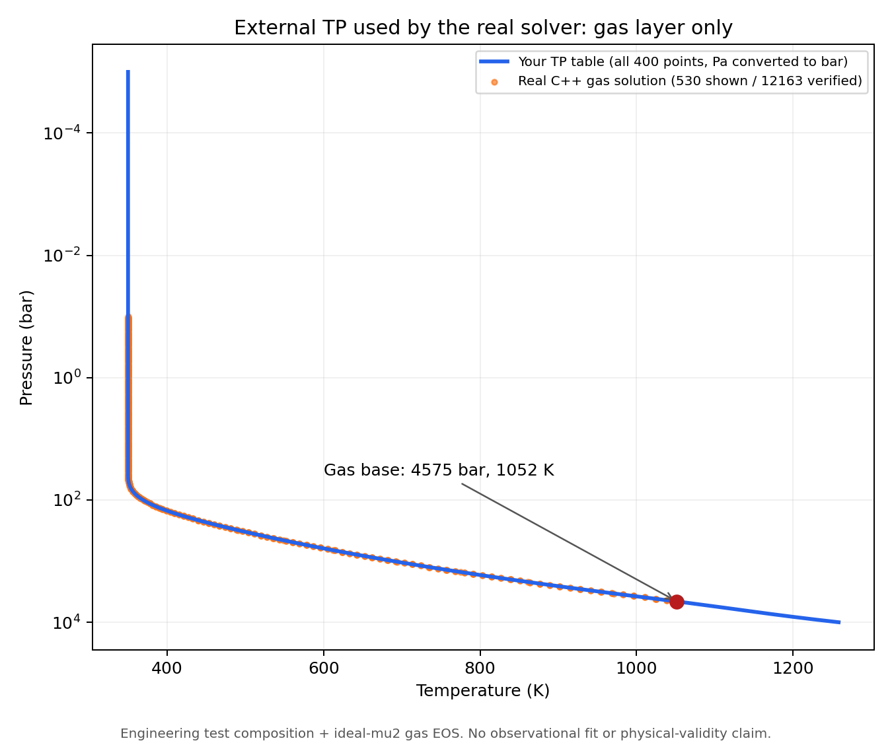

# 用自己的TP接通真实MAGRATHEA：单例工程验证

**已经接通真实C++程序。** 你的400个TP点只转换了压力单位，温度和点数均未改变。程序需要某个压力的温度时，调用现有 `TPProfile::at_cgs`，在你给的点之间作T-ln(P)插值；气层没有再走内置的等温/绝热温度处方。密度仍由指定EOS按当前P、T计算。

这次测试设定下的半径约 **2.14832个地球半径**。同一组成加严数值容差再算一次，结果一致；这两次是同一物理输入的数值检查，不是两组独立物理实验，也没有拿观测去拟合组成。

|实际运行|半径 / RE|进程耗时|数值检查|
|---|---:|---:|---|
|基准|2.1483191091726397|21.56s|PASS|
|加严容差|2.148319087507168|16.02s|PASS|

两次相对差约1.0085e-8；这是数值设置敏感性检查，不是物理误差或统计置信区间。



蓝线是你的完整TP；橙点是实际求解所得气层点的绘图抽样。所有12163个气层点均逐点检查了T(P)及密度，绘图只抽样显示。气层底部约4575bar、1052K，在原表最高10000bar以内，没有外推。气层以下的独立水层、硅酸盐和铁核仍按原有内部热结构模型求解；没有把这份气层TP硬套到中心。

## 这次用了什么设定

- 总质量8.04ME，沿用交接给定基准。
- 测试质量分数：铁25.22727%、硅酸盐55.5%、独立水层19.17273%、气体0.1%。这些不是反演得到的真实组成。
- 外边界沿用工程设置P0=0.1bar；T0=350K来自你的廓线插值，没有平移曲线。
- 气体采用现有 `gas_fixed_mu2` 理想气体工程EOS；铁、硅酸盐、水沿用原选择器；所有层间温度跳变为0。
- **physical_acceptance=false**：当前结果说明这组测试假设能完成真实结构求解，正式H/He EOS、TP来源/成分/重力及参考压力尚需确认。没有宣称观测拟合、真实组成或大气自洽。

运行前已冻结 `runtime-contract.json`：最多2次真实前向程序调用，每次180s；只有基准通过后才做同物理输入的加严确认。`runtime-ledger.json` 持久记录实际2次，已关闭。C++内部shooting/边界配平属于一次结构求解的数值过程，没有扫描组成或重启旧14次拟合合同。

## 已实现和复核的东西

`workflow/tp_import.py` 读取明确Pa/K的空白分隔文件，拒绝错误单位、坏点、重复压力和覆盖旧输出；保存原始字节、转换后CSV、代码快照及哈希。`workflow/tp_query.cpp` 只调用已有C++加载与插值接口，没有重写EOS或TP算法。DeepSeek实现，Codex固定测试、诊断、独立审核；11项新测试通过，转换后的实际用户文件也走过原mock流程。

真实程序由当前物理源码和表格的干净副本重新编译；原源码/EOS、原portable.py、旧实验及旧二进制未改。实际运行ELF、39项编译依赖身份及必要原字节快照保存在 `build/`。独立保存结果审计见 `evidence/real-solver-audit.json`；该审计不重新执行模型。原生插值400节点及6个中间点的检查在evidence中。

## 安全地复查结果：只读、不跑模型

```powershell
python -B experiments/external-tp-bridge-20261106/verify_archive.py
```

它核对档案哈希，并用现有 `tests/check_tp_model.py` 的当时字节快照检查两份真实高精度输出。这里的PASS只指受限数值工程验收。

输入使用 `converted/source.pt` 保留你给的原字节；`converted/profile.csv` 为转换后的400点。源文件SHA256为d389fdae192d22bd57a50439bb487932e7d4df3782709f7372f7bf785926f50c。`evidence/reproduce_real_probe.py` 是当时的确定性运行记录脚本，读取已关闭账本后会拒绝重放；新实验必须建立新目录和新合同。

## 网站分析与下一项重大选择

已按你的要求查过相关聊天，并查看[原Code Lab气层分析](https://magrathea-code-lab.rainymink8.chatgpt.site/phase-atlas/gas/index.html)的本地源文及温度分析报告§9–10。网站早于现有外部TP接口；当前代码已实现T-ln(P)插值。外部TP插值和EOS的密度/热力学查表是两件事；原gas_default的100bar切换同时改变热处方和分子量，本段没有移动它或把它当作真实RCB。

下一项重大选择是正式模型采用的H/He密度EOS、层组成和半径参考压力，以及这份TP是否与它们相容。当前停在已验证的真实程序单例，不自动把测试值变成生产默认，也不开始grid、组成拟合或新EOS开发。


档案另外封存了全部39项编译源码/表格与当时检查器，供主程序以后变化时独立只读复查。原始验收合同和运行前合同保持字节不变；`portable-recheck-contract.json` 只把源码身份路径改为档案内的相同字节副本，所有数值阈值、构建/配置/TP/输出哈希均未改变，等价校验见evidence/portable-verification-equivalence.json。此包装步骤没有调用solver。
