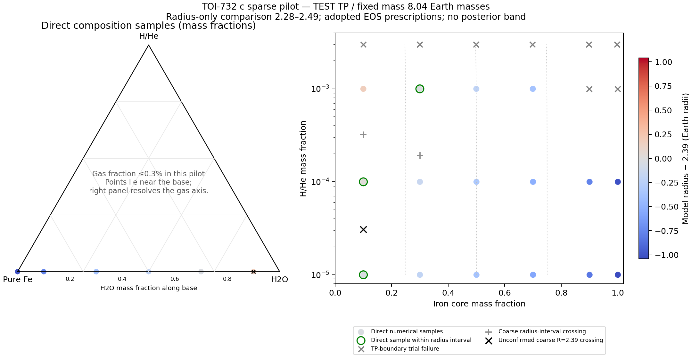

# TOI-732 c：纯铁核 / 水 / H-He 稀疏测试版

从 `26b7b72` 开始，在 **run** 分支开发。完成稀疏扫描测试就停止，master 不变。这些是**真实 C++ solver 使用示范 TP 的条件测试结果**，尚不是正式论文组成后验。

## 实现和结果

纯铁核 + 独立水层 + H/He，硅酸盐质量为 0。气层逐点使用外部 TP，密度统一调用已有 Chabrier H/He 表（Y=0.275），不在 100 bar 换理想气体。水/铁保留现有热结构。逐行检查材料、EOS、温压、密度和表格范围，越界不外推。

流程：配置 → 新目录冻结源码/TP → 编译 → 记账后调用 solver → 独立检查 → 保存原始输出或失败原因。DeepSeek写计算代码；Codex负责验收、固定实验编排及分析。原 `workflow/portable.py` 未改。

修复了一处旧代码错误：铁核切换到水层时，密度调用误用旧温度 `Tt`，现在使用当前 `y[2]`。EOS公式、表格、热闭合和阈值未改。合成回归旧码失败、新码误差0；原失败批次完整保留在 `data/run01`。

修复后4代表组成 + 第一个组成加严复算，共5次全部通过独立实际审核，检查56,434条内部记录。普通/加严半径相对差约 `1.14574e-8`，随后只扫描固定24点。

| 项目 | 结果 |
|---|---:|
| 网格尝试 | 24 |
| 通过检查 | 16 |
| TP上边界初始试探失败 | 8 |
| 通过点中落在半径比较区间 | 3 |
| 本段所有真实前向次数 | 31 / 36 |
| DeepSeek本段 / 全项目 | 19 / 85（上限88） |

固定质量 `8.04 M_E`，目标半径 `2.39 R_E`，仅比较半径区间 `[2.28,2.49] R_E`。原程序地球赤道半径常数为 `6.3781e8 cm`。

**16个通过点中最接近目标的直接样本：**

| 铁 | 硅酸盐 | 水 | H/He | 计算半径 |
|---:|---:|---:|---:|---:|
| 29.97% | 0 | 69.93% | 0.10% | 2.3735947618 R_E |

这是已通过稀疏点中的最近点，不是全局最优或唯一组成。中心半径只有一个尚未用solver确认的粗插值候选，**完整组成匹配线尚未得到**。

[数值报告](report.json) · [24点数据表](data/run02/points.csv) · [完整摘要](data/run02/summary.json)



[矢量SVG](data/run02/figures/pilot-composition.svg) · [单例物态/温压剖面](data/run02/figures/single-planet-phases.png)

绿圈为直接计算且在半径区间内的点；黑叉为未确认粗插值；灰叉为失败。没有把失败点连成匹配线，也没有绘制后验带。

## 失败点的含义

8点都在**初始半径试探**求TP上边界时被拒绝：压力比 `1e10 dyn/cm2` 高约 `1.2e-14`（相对值）。日志不足以证明真实星球解一定需要更深TP；应先查边界舍入与初始化。失败点不能当成观测排除。

[失败审计与原始日志位置](data/run02/failure-audit.json)。本轮到此停止，没有加密、加速或追加计算。

## 自己运行

在仓库根目录执行，复用现有WSL、g++及GSL。计算不调用任何模型API，不重新安装工具。

只读核验现有归档，不调用solver：

```powershell
python -B experiments/pure-fe-pilot-20261106/verify_archive.py
python -B experiments/pure-fe-pilot-20261106/run_pilot.py --stage verify --output D:/Codex/downloads/subneptune-research-workflow/experiments/pure-fe-pilot-20261106/data/run02
```

在干净的run检出中复现计算，分为两步：

```powershell
python -B experiments/pure-fe-pilot-20261106/run_pilot.py --stage single --output D:/Codex/downloads/toi732c-my-pilot
python -B experiments/pure-fe-pilot-20261106/run_pilot.py --stage grid --output D:/Codex/downloads/toi732c-my-pilot
```

第一步必须是全新目录，4代表+1加严通过后第二步才允许扫描。跨目录重试共用仓库 `.runs/campaign-pure-fe-pilot-20261106.json` 的36次上限。本开发检出已用31次，不应重跑本批次；新研究批次须另行明确版本/campaign，保留旧账本。干净检出不继承未提交的运行账本。

不要直接执行归档的旧 `run.cfg`，它们保留当时绝对路径。控制器会为新目录生成配置。

只重画已有数据：

```powershell
python -B experiments/pure-fe-pilot-20261106/plot_pilot.py D:/Codex/downloads/subneptune-research-workflow/experiments/pure-fe-pilot-20261106/data/run02
```

[配置样例](../../workflow/examples/toi732c-pilot.json)是冻结测试配置，限定M8.04、P0=.1bar、T0=350K及本次网格，尚未扩展成任意输入/统计反演平台。

## 证据和限制

[原合同](contract.json) · [单参数修复合同](contract-repair-01.json) · [真实单例独立审核](evidence/independent-single-review.json) · [修复证据](evidence/repair-01/) · [最终验收](evidence/final-review.json)

`data/run01` 保留原失败；`data/run02` 保存单例、全部网格尝试、错误日志、工件哈希、实际编译源码/表格/ELF。大JSON原样保存，未截断。`archive-index.json` 绑定归档字节，提交还核对Git index/committed blob。

单元日志中的 `2.4 R_E` 是模拟占位数；合成EOS回归也不是观测行星。真实结果以 `data/run*/` 为准，[来源标记](origin-labels.json)区分三者。

示范TP尚无正式物理来源确认。本版验证既有相图/EOS设置下的调用、状态一致性和数值检查，不认证经验EOS全范围有效性、相稳定性或跨相热力学一致性；IceX等热类型0保留。当前没有质量误差传播、完整联合误差带或组成后验。
